```mermaid
flowchart TD
    In["Noisy Audio: x(t) [16 kHz]"] --> STFT["Causal STFT (N_fft=512, Hop=256, Asymmetric Square-Root Hann)<br/>τ_algo = 16.0 ms, τ_lookahead = 0.0 ms"]
    STFT --> FeatExt["Input Features: [Yr, Yi, |Y|^0.3] -> Shape: (B, 3, T, 257)"]

    subgraph FrontEnd ["Acoustic Subband Front-End (GTCRN Heritage)"]
        FeatExt --> BM["Glasberg-Moore ERB Band Merging (BM):<br/>• Bins 0..63 (0 - 2 kHz): 64 linear bins (1:1 identity)<br/>• Bins 64..256 (2 - 8 kHz): 193 linear bins -> 64 ERB subbands<br/>Output: (B, 3, T, 128)"]
        BM --> SFE["Subband Feature Extraction (SFE, k=3):<br/>Unfolds adjacent frequency context into channels<br/>Output: (B, 9, T, 128)"]
    end

    subgraph Encoder ["Causal Depthwise-Separable Encoder (DeepFilterNet Stage 1 Heritage)"]
        SFE --> Conv0["enc0: CausalSeparableConv2d (k=3x3, stride 1,1) -> (B, 64, T, 128)<br/>DWConv (9ch) + PWConv (9->64ch) + GroupNorm + Mish"]
        Conv0 --> Conv1["enc1: CausalSeparableConv2d (k=3x3, stride 1,2) -> (B, 64, T, 64)<br/>DWConv (64ch, s=1,2) + PWConv (64->64ch) + GroupNorm + Mish"]
        Conv1 --> Conv2["enc2: CausalSeparableConv2d (k=3x3, stride 1,2) -> (B, 64, T, 32)<br/>DWConv (64ch, s=1,2) + PWConv (64->64ch) + GroupNorm + Mish"]
        Conv2 --> Conv3["enc3: CausalSeparableConv2d (k=3x3, stride 1,2) -> (B, 64, T, 16)<br/>DWConv (64ch, s=1,2) + PWConv (64->64ch) + GroupNorm + Mish"]
    end

    subgraph Bottleneck ["Dilated-Recurrent Bottleneck (ADCB + Causal Uni-GRU)"]
        Conv3 --> ADCB["Frequency Path: ADCB Module (Parallel Dilated Conv1D, d=1,2,4)<br/>Receptive Field = 15/16 bins (Zero RNN Step Loops)"]
        ADCB --> UniGRU["Temporal Path: Causal Uni-GRU across T (Hidden=64)"]
        UniGRU --> CausalConvGLU["Channel Mixer: Causal ConvGLU (DWConv 3x3 + Mish Gating)"]
        CausalConvGLU --> BotOut["Bottleneck Output: (B, 64, T, 16)"]
    end

    subgraph Decoder ["Causal Separable Transposed Conv Decoder with Skip Additions"]
        BotOut --> Add3["(+)"]
        Conv3 -.->|Skip Connection| Add3
        Add3 --> Up3["up3: CausalSeparableConvTranspose2d (k=1x3, s=1,2) -> (B, 64, T, 32)<br/>PWConv (64->64ch) + DW-TConv (64ch, s=1,2) + GroupNorm + Mish"]

        Up3 --> Add2["(+)"]
        Conv2 -.->|Skip Connection| Add2
        Add2 --> Up2["up2: CausalSeparableConvTranspose2d (k=1x3, s=1,2) -> (B, 64, T, 64)<br/>PWConv (64->64ch) + DW-TConv (64ch, s=1,2) + GroupNorm + Mish"]

        Up2 --> Add1["(+)"]
        Conv1 -.->|Skip Connection| Add1
        Add1 --> Up1["up1: CausalSeparableConvTranspose2d (k=1x3, s=1,2) -> (B, 64, T, 128)<br/>PWConv (64->64ch) + DW-TConv (64ch, s=1,2) + GroupNorm + Mish"]

        Up1 --> Add0["(+)"]
        Conv0 -.->|Skip Connection| Add0
        Add0 --> FinalConv["final_conv: 1x1 Conv2d (out_channels=2)"]
        FinalConv --> AmpTanh["Amplified Tanh: β·tanh(z/β), β=2.0<br/>Subband Mask M_sub: [Mr, Mi] ∈ [-2.0, 2.0]<br/>Shape: (B, 2, T, 128)"]
    end

    subgraph BackEnd ["Energy-Normalized Band Splitting & CRM Synthesis"]
        AmpTanh --> MatrixBS["Matrix Band Splitting (BS via W_bs):<br/>• Bins 0..63: Unaltered linear mask<br/>• Bins 64..256: M_linear = M_erb · W_bs (193 bins)<br/>Output: Full Mask M(t, f) (B, 2, T, 257)"]
        MatrixBS --> CRM_Mult["Complex Ratio Masking (CRM): Ŝ = Y ⊙ M<br/>Ŝr = Yr·Mr - Yi·Mi<br/>Ŝi = Yr·Mi + Yi·Mr"]
        CRM_Mult --> iSTFT["iSTFT Waveform Synthesis (Hop=256, OLA)"]
        iSTFT --> Out["Enhanced Audio: ŝ(t) [16 kHz]<br/>Total Latency: 16.0 ms (algo) + 1.25 ms (exec) = 17.25 ms"]
    end
```

# DuoFilter: Ultra-Lightweight Subband Dilated-Recurrent U-Net with Causal Depthwise-Separable Stages and Amplified CRM

**Production & Research Specification Blueprint**  
**Genealogy:** Synthesis of **GTCRN** (Front-End BM/BS & CRM synthesis), **DeepFilterNet** (Causal Depthwise-Separable U-Net stages & Causal EMA Normalization), and **LiSenNet** (Dual-Path Decoupled Bottleneck modernized with **ADCB** parallel frequency modeling)  
**Target Platform:** Ultra-Low-Complexity, Real-Time Edge Speech Enhancement & Dereverberation (16 kHz, strictly causal, zero lookahead, $\le 16.0\text{ ms}$ algorithmic latency)  
**Evaluation Benchmark:** VoiceBank + DEMAND Test Corpus & Deep Noise Suppression (DNS)  

---

## 📑 Table of Contents
- [1. Executive Summary & Core Innovations](#1-executive-summary--core-innovations)
- [2. Directory Structure](#2-directory-structure)
- [3. The Use of Each File (Module Breakdown)](#3-the-use-of-each-file-module-breakdown)
  - [`DuoFilter.py`](#duofilterpy)
  - [`ERBFilterBank.py`](#erbfilterbankpy)
  - [`Layer.py`](#layerpy)
  - [`EMANorm.py`](#emanormpy)
  - [`loss.py`](#losspy)
  - [`dataset_generator.py`](#dataset_generatorpy)
  - [`model.ipynb`](#modelipynb)
  - [`requirements.txt`](#requirementstxt)
  - [`checkpoint/duofilter_best_model.ckpt`](#checkpointduofilter_best_modelckpt)
- [4. Environment Setup & Installation](#4-environment-setup--installation)
  - [Step 1: Create Virtual Environment](#step-1-create-virtual-environment)
  - [Step 2: Install PyTorch & Torchaudio](#step-2-install-pytorch--torchaudio)
  - [Step 3: Install Project Dependencies](#step-3-install-project-dependencies)
  - [Step 4: Verify Installation](#step-4-verify-installation)
- [5. Dataset Preparation & Sources](#5-dataset-preparation--sources)
- [6. How to Run DuoFilter](#6-how-to-run-duofilter)
  - [A. Audio Enhancement / Denoising (Inference)](#a-audio-enhancement--denoising-inference)
  - [B. Batch Directory Enhancement](#b-batch-directory-enhancement)
  - [C. Model Training from Scratch](#c-model-training-from-scratch)
  - [D. VoiceBank+DEMAND Objective Evaluation](#d-voicebankdemand-objective-evaluation)
  - [E. Running with Interactive Notebook (`model.ipynb`)](#e-running-with-interactive-notebook-modelipynb)
- [7. End-to-End System Pipeline & Tensor Flowchart](#7-end-to-end-system-pipeline--tensor-flowchart)
- [8. Mathematical Methodology & Formulations](#8-mathematical-methodology--formulations)
- [9. Layer-by-Layer Dimension Mapping & Parameter Budget](#9-layer-by-layer-dimension-mapping--parameter-budget)
- [10. Empirical Benchmark Results (VoiceBank + DEMAND)](#10-empirical-benchmark-results-voicebank--demand)
- [11. References](#11-references)

---

## 1. Executive Summary & Core Innovations

**DuoFilter** is an ultra-lightweight, strictly causal convolutional-recurrent neural network designed for high-fidelity speech enhancement and dereverberation on edge devices (microcontrollers, smart speakers, IoT audio processors). 

By adopting **DeepFilterNet Stage 1's Depthwise-Separable Convolutional topology** across the entire encoder and decoder U-Net, DuoFilter achieves an extremely compact footprint of **$89.77\text{k}$ parameters** and **$130.97\text{ MMACs/sec}$** (only $0.131\text{ GMACs/sec}$), operating with **zero lookahead** and **$16.0\text{ ms}$ algorithmic buffering delay**.

### The 5 Architectural Pillars:
1. **Causal Depthwise-Separable Encoder/Decoder (DeepFilterNet Stage 1 Heritage):**  
   Replaces parameter-heavy dense 2D convolutions with `CausalSeparableConv2d` and `CausalSeparableConvTranspose2d`. Decouples spatial time-frequency filtering from cross-channel linear combination, slashing convolutional parameter count by **$87.3\%$** while preserving 64-channel feature capacity.
2. **Parallelized Frequency Modeling via ADCB:**  
   Eliminates sequential intra-frame bidirectional RNN passes in favor of an **Asymmetric Dilated Convolutional Block (ADCB)** with dilations $d \in \{1, 2, 4\}$. Achieves a large receptive field of 15 subbands across frequency in parallel with zero sequential recurrence along frequency.
3. **Glasberg & Moore (1990) Psychoacoustic ERB Band Merging & Splitting (GTCRN Heritage):**  
   Partitions the 257-bin linear spectrum into 64 unaltered linear bins ($0\text{--}2\text{ kHz}$) and 64 non-linearly expanding Equivalent Rectangular Bandwidth (ERB) subbands ($2\text{--}8\text{ kHz}$), inverted via an energy-normalized transpose synthesis matrix $\mathbf{W}_{\text{bs}} = \mathbf{W}_{\text{erb}}^T \oslash \sum \mathbf{W}_{\text{erb}}^T$.
4. **Causal Exponential Moving Average (EMA) Normalization:**  
   Normalizes subband features online frame-by-frame across time without future frame lookahead, maintaining numerical stability and consistent dynamic range without FP16 overflow.
5. **Amplified Complex Ratio Masking ($\beta = 2.0$):**  
   Applies $\beta \cdot \tanh(z / \beta)$ with $\beta = 2.0$, providing $+6.02\text{ dB}$ of dynamic expansion headroom to invert destructive acoustic phase cancellation in harsh and negative SNR conditions.

---

## 2. Directory Structure

The directory layout of `code/DuoFilter/` is organized as follows:

```text
code/DuoFilter/
├── README.md                      # Comprehensive technical specification & operational guide
├── requirements.txt               # Python package dependencies & version pins
├── DuoFilter.py                   # Top-level neural network architecture & subband pipeline
├── ERBFilterBank.py               # Psychoacoustic ERB filterbank (BM/BS) & STFT / iSTFT routines
├── Layer.py                       # Causal depthwise, transposed, and pointwise convolutional layers
├── EMANorm.py                     # Numerically stable Causal Exponential Moving Average normalizer
├── loss.py                        # Multi-Resolution Inside-Norm loss function
├── dataset_generator.py           # On-the-fly multi-noise mixing & RIR dereverberation DataLoader
├── model.ipynb                    # End-to-end interactive training, evaluation & demo notebook
└── checkpoint/
    └── duofilter_best_model.ckpt  # Pretrained model checkpoint (state_dict & optimizer)
```

---

## 3. The Use of Each File (Module Breakdown)

### DuoFilter.py
Defines the primary neural network architecture and end-to-end forward computation graph:
- **`CausalSeparableConv2d`**: Encoder block pairing depthwise 2D causal convolution (`kernel_size=(3, 3)`) with pointwise 1x1 convolution, Mish activation, and GroupNorm.
- **`CausalSeparableConvTranspose2d`**: Decoder upsampling block pairing pointwise 1x1 convolution with causal depthwise transposed convolution (`kernel_size=(1, 3)`, `stride=(1, 2)`).
- **`ADCB` (Asymmetric Dilated Convolutional Block)**: 1D depthwise dilated convolutional stack along the frequency dimension ($F=16$, $d=\{1, 2, 4\}$) with Mish, GroupNorm, and residual connections.
- **`CausalConvGLU`**: Bottleneck channel mixer featuring depthwise 3x3 causal temporal convolution with Mish and Gated Linear Unit (GLU) sigmoid gating.
- **`ADCB_Temporal_Bottleneck`**: Hybrid bottleneck chaining the frequency ADCB, a strictly causal Uni-GRU across time ($H=64$), and the `CausalConvGLU`.
- **`DuoFilter`**: Top-level `nn.Module` executing:
  $$\text{STFT} \xrightarrow{} \text{ERB BM (128 subbands)} \xrightarrow{} \text{EMA Norm} \xrightarrow{} \text{SFE } (k=3) \xrightarrow{} \text{Encoder} \xrightarrow{} \text{Bottleneck} \xrightarrow{} \text{Decoder} \xrightarrow{} \text{CRM Mask} \xrightarrow{} \text{ERB BS} \xrightarrow{} \text{iSTFT}$$

### ERBFilterBank.py
Implements psychoacoustically grounded spectral domain transformations:
- **`ERBFilterBank`**: Constructs Glasberg & Moore (1990) triangular ERB filters:
  - **Low-band ($0\text{--}2\text{ kHz}$, bins $0\dots 63$):** 1:1 Identity mapping preserving harmonic pitch structures.
  - **High-band ($2\text{--}8\text{ kHz}$, bins $64\dots 256$):** 193 linear bins compressed into 64 ERB filters.
  - **`bm(x)` (Band Merging):** Projects $(B, C, T, 257) \to (B, C, T, 128)$.
  - **`bs(x)` (Band Splitting):** Reconstructs $(B, C, T, 128) \to (B, C, T, 257)$ via energy-normalized transpose weighting.
- **`wav_to_stft(...)`**: Converts 16 kHz time-domain audio to complex STFT spectrograms ($N_{\text{fft}}=512$, $\text{hop}=256$, square-root Hann window, causal symmetric padding).
- **`stft_to_wav(...)`**: Overlap-add inverse STFT (iSTFT) synthesis with float32 type-casting to prevent half-precision crashes under AMP (`torch.autocast`).

### Layer.py
Provides reusable, causal building block layers:
- **`get_groups(channels, max_groups=4)`**: Helper computing the largest divisor $\le 4$ for stable GroupNorm configuration.
- **`CausalDepthwiseConv2d`**: Depthwise 2D convolution (`groups=in_ch`) using asymmetric temporal padding `(kf // 2, kf // 2, kt - 1, 0)` ensuring strict zero-lookahead causality.
- **`CausalDepthwiseConvTranspose2d`**: Depthwise transposed 2D convolution for frequency upsampling with causal temporal slicing (`:-(kt - 1)`).
- **`PConv2d`**: Pointwise ($1\times 1$) 2D convolution for channel expansion/reduction with optional GroupNorm and Mish activation.

### EMANorm.py
Implements **`CausalEmaNorm`**:
- Tracks running mean and variance online across the time frames $t \in [0, T-1]$ using causal momentum recursion ($\alpha = 0.99$, $\epsilon = 10^{-5}$).
- Zero future frame leakage, ensuring strict online streaming compatibility and preventing FP16 activation overflow.

### loss.py
Implements **`MultiResolutionNormLoss`**:
- Integrates inside-norm power compression ($c=0.3$) where $\epsilon = 10^{-6}$ is placed directly inside the power norm:
  $$\mathcal{L}_{\text{total}} = 0.50 \cdot \mathcal{L}_{\text{mag}} + 0.30 \cdot \mathcal{L}_{\text{cplx}} + 0.20 \cdot \mathcal{L}_{\text{MR}}$$
- **$\mathcal{L}_{\text{mag}}$**: Power-compressed STFT magnitude MSE loss.
- **$\mathcal{L}_{\text{cplx}}$**: Inside-norm stabilized complex STFT MSE loss.
- **$\mathcal{L}_{\text{MR}}$**: Multi-resolution spectral L1 loss computed across window sizes $\{256, 512, 1024\}$ and hop sizes $\{128, 256, 512\}$ to eliminate harmonic distortion.

### dataset_generator.py
Implements **`DynamicMixingDataset`**:
- High-fidelity on-the-fly speech simulation pipeline for training and evaluation.
- **Dynamic Multi-Noise Mixture:** Concurrently superimposes 1 to 5 random background noise sources.
- **Acoustic RIR Simulation:** Convolves clean speech with Room Impulse Responses (50% probability), partitioning into full reverberant microphone input and early reflections target ($\le 50\text{ ms}$ with 30 ms cosine attenuation window).
- **Two-Stage $-25\text{ dBFS}$ Normalization:** Calibrates speech and noise before mixing with random SNR chosen from $\{-5, 0, 5, 10, 15, 20\}\text{ dB}$.
- **Floating Dynamic Range:** Injects random $\pm 10\text{ dBFS}$ gain variation to simulate speaker distance and vocal effort (whisper to shout).
- **Headroom Limiter:** Clips maximum peak amplitude to $0.95$ to prevent DAC clipping.

### model.ipynb
All-in-one Jupyter Notebook with end-to-end execution cells:
- Dataset directory bindings (compatible with Kaggle and Google Colab).
- Training loop with mixed precision (`torch.amp.autocast`), AdamW, `ReduceLROnPlateau`, and gradient norm clipping ($5.0$).
- Training / validation loss curve plotting.
- Comprehensive VoiceBank+DEMAND benchmark suite computing PESQ, STOI, SI-SDR, CSIG, CBAK, and COVL.
- Interactive audio player (`IPython.display.Audio`) for subjective comparison.

### requirements.txt
Specifies dependencies:
- Deep learning & DSP: `torch>=2.0.0`, `torchaudio>=2.0.0`, `soundfile>=0.12.1`, `numpy>=1.22.0`.
- Speech evaluation: `pesq>=0.0.4`, `pystoi>=0.3.3`, `pysepm` (via direct GitHub archive).
- Profiling & analysis: `thop>=0.1.1`, `pandas>=1.5.0`, `matplotlib>=3.5.0`, `openpyxl>=3.0.0`.

### `checkpoint/duofilter_best_model.ckpt`
The official pretrained model checkpoint (size: $\approx 1.2\text{ MB}$). Contains:
- `checkpoint["model_state_dict"]`: Weights of the trained DuoFilter model.
- `checkpoint["optimizer_state_dict"]`: Optimizer state for resumption.

---

## 4. Environment Setup & Installation

### Step 1: Create Virtual Environment
We recommend **Python 3.10** for compatibility with `pesq`, `pystoi`, and `pysepm`:

```bash
# Using Conda:
conda create -n duofilter python=3.10 -y
conda activate duofilter

# Or using venv:
python3.10 -m venv .venv
source .venv/bin/activate
```

### Step 2: Install PyTorch & Torchaudio
Select the appropriate command for your hardware:

- **Linux / Windows with CUDA (Recommended for Training):**
  ```bash
  pip install torch>=2.0.0 torchaudio>=2.0.0 --index-url https://download.pytorch.org/whl/cu121
  ```
- **macOS (Apple Silicon M1/M2/M3/M4 via MPS) or CPU-only:**
  ```bash
  pip install torch>=2.0.0 torchaudio>=2.0.0
  ```

### Step 3: Install Project Dependencies
Navigate to `code/DuoFilter/` and install:

```bash
cd code/DuoFilter/
pip install -r requirements.txt
```

> [!NOTE]
> `pysepm` is compiled directly from GitHub to support composite metrics (CSIG, CBAK, COVL). If your system lacks a C compiler, install Xcode Command Line Tools on macOS (`xcode-select --install`) or build-essential on Linux (`sudo apt-get install build-essential`).

### Step 4: Verify Installation
Verify that all packages and CUDA / MPS accelerators are correctly detected:

```bash
python -c "import torch, torchaudio, soundfile, pesq, pystoi; print('PyTorch version:', torch.__version__); print('CUDA available:', torch.cuda.is_available()); print('MPS available:', torch.backends.mps.is_available())"
```

---

## 5. Dataset Preparation & Sources

All training and evaluation datasets used in this work are hosted on Kaggle under user **`quanninhhoang`**:

| Dataset | Kaggle Handle | Description |
|:---|:---|:---|
| **Clean Speech** | `quanninhhoang/dns-cleanspeech-dataset` | Clean speech recordings from DNS Challenge (`train/`, `val/`, `test/`) |
| **Noise Corpus** | `quanninhhoang/dns-noise-dataset` | Environmental noises across diverse scenarios (`train/`, `val/`, `test/`) |
| **Room Impulse Responses (RIR)** | `quanninhhoang/dns-impulse-dataset` | Simulated and measured RIR files for reverberation modeling |
| **VoiceBank + DEMAND** | `quanninhhoang/voicebank-demand` | Standard speech enhancement benchmark (`clean_testset_wav/`, `noisy_testset_wav/`) |

To download datasets locally using the Kaggle CLI:
```bash
kaggle datasets download -d quanninhhoang/voicebank-demand --unzip -p data/voicebank_demand
kaggle datasets download -d quanninhhoang/dns-cleanspeech-dataset --unzip -p data/clean
kaggle datasets download -d quanninhhoang/dns-noise-dataset --unzip -p data/noise
kaggle datasets download -d quanninhhoang/dns-impulse-dataset --unzip -p data/rir
```

---

## 6. How to Run DuoFilter

All commands below assume you are operating in the `code/DuoFilter/` directory:
```bash
cd code/DuoFilter
```

---

### A. Audio Enhancement / Denoising (Inference)

Here is a complete, self-contained Python script to enhance a noisy audio file using the pretrained checkpoint:

```python
import os
import torch
import torchaudio
import soundfile as sf
from DuoFilter import DuoFilter
from ERBFilterBank import wav_to_stft, stft_to_wav

def enhance_audio(
    input_wav_path: str,
    output_wav_path: str,
    checkpoint_path: str = "checkpoint/duofilter_best_model.ckpt",
    sample_rate: int = 16000,
    device: str = "auto"
):
    # 1. Device selection
    if device == "auto":
        dev = torch.device("cuda" if torch.cuda.is_available() else ("mps" if torch.backends.mps.is_available() else "cpu"))
    else:
        dev = torch.device(device)
    print(f"Executing inference on: {dev}")

    # 2. Instantiate DuoFilter model architecture
    model = DuoFilter(
        beta=2.0,
        use_skip_pconv=False,
        dropout_p=0.0,
        use_ema_norm=True
    ).to(dev)

    # 3. Load pretrained checkpoint
    if os.path.exists(checkpoint_path):
        ckpt = torch.load(checkpoint_path, map_location=dev, weights_only=False)
        state_dict = ckpt["model_state_dict"] if "model_state_dict" in ckpt else ckpt
        model.load_state_dict(state_dict)
        print(f"Successfully loaded checkpoint: {checkpoint_path}")
    else:
        raise FileNotFoundError(f"Checkpoint not found at: {checkpoint_path}")

    model.eval()

    # 4. Load & preprocess audio
    noisy_wav, sr = torchaudio.load(input_wav_path)
    if sr != sample_rate:
        noisy_wav = torchaudio.functional.resample(noisy_wav, sr, sample_rate)
    
    # Downmix to mono and move to device
    noisy_wav = noisy_wav.mean(dim=0, keepdim=True).to(dev)  # Shape: [1, L]
    orig_length = noisy_wav.shape[-1]

    # 5. Causal STFT Analysis
    window = torch.hann_window(window_length=512, device=dev).pow(0.5)
    with torch.inference_mode():
        # [1, T, 257] complex spectrogram
        spec = wav_to_stft(noisy_wav, n_fft=512, hop_length=256, win_length=512, window=window)
        
        # Real & imaginary input: [1, 2, T, 257]
        noisy_input = torch.stack([spec.real, spec.imag], dim=1)

        # 6. Model forward pass
        enhanced_stft = model(noisy_input)

        # 7. Inverse STFT Synthesis
        enhanced_cplx = torch.complex(enhanced_stft[:, 0].float(), enhanced_stft[:, 1].float())
        enh_wav = stft_to_wav(
            enhanced_cplx,
            n_fft=512,
            hop_length=256,
            win_length=512,
            window=window.float(),
            length=orig_length
        ).squeeze(0)

    # 8. Save enhanced output
    os.makedirs(os.path.dirname(output_wav_path) or ".", exist_ok=True)
    sf.write(output_wav_path, enh_wav.squeeze().cpu().numpy(), sample_rate)
    print(f"Enhanced audio saved to: {output_wav_path}")

if __name__ == "__main__":
    enhance_audio(
        input_wav_path="sample_noisy.wav",
        output_wav_path="sample_enhanced.wav",
        checkpoint_path="checkpoint/duofilter_best_model.ckpt"
    )
```

---

### B. Batch Directory Enhancement

To denoise an entire folder of noisy audio files:

```python
import glob
import os
from enhance import enhance_audio  # Function defined above

input_dir = "data/noisy_recordings"
output_dir = "data/enhanced_recordings"
wav_files = sorted(glob.glob(os.path.join(input_dir, "*.wav")))

print(f"Found {len(wav_files)} audio files to enhance...")
for wav_path in wav_files:
    filename = os.path.basename(wav_path)
    out_path = os.path.join(output_dir, filename)
    enhance_audio(input_wav_path=wav_path, output_wav_path=out_path)
```

---

### C. Model Training from Scratch

To train DuoFilter on your own dataset using `dataset_generator.py` and `loss.py`:

```python
import torch
from torch.utils.data import DataLoader
from DuoFilter import DuoFilter
from loss import MultiResolutionNormLoss
from dataset_generator import DynamicMixingDataset
from ERBFilterBank import wav_to_stft, stft_to_wav

# Hyperparameters
device = torch.device("cuda" if torch.cuda.is_available() else "cpu")
batch_size = 32
epochs = 30
learning_rate = 5e-4
segment_samples = 48000  # 3 seconds @ 16 kHz

# 1. Initialize Datasets & DataLoaders
train_dataset = DynamicMixingDataset(
    clean_dir="data/clean/train",
    noise_dir="data/noise/train",
    rir_dir="data/rir/train",
    segment_samples=segment_samples,
    flag=False  # Stochastic training randomization
)
val_dataset = DynamicMixingDataset(
    clean_dir="data/clean/val",
    noise_dir="data/noise/val",
    rir_dir="data/rir/val",
    segment_samples=segment_samples,
    flag=True   # Deterministic validation seeding
)

train_loader = DataLoader(train_dataset, batch_size=batch_size, shuffle=True, num_workers=4, pin_memory=True)
val_loader = DataLoader(val_dataset, batch_size=batch_size, shuffle=False, num_workers=4)

# 2. Instantiate Model, Loss & Optimizer
model = DuoFilter(beta=2.0, use_skip_pconv=False, dropout_p=0.1, use_ema_norm=True).to(device)
criterion = MultiResolutionNormLoss(fft_sizes=(256, 512, 1024), hop_sizes=(128, 256, 512), c=0.3, eps=1e-6).to(device)
optimizer = torch.optim.AdamW(model.parameters(), lr=learning_rate, weight_decay=1e-4)
scheduler = torch.optim.lr_scheduler.ReduceLROnPlateau(optimizer, mode="min", factor=0.5, patience=2)
scaler = torch.amp.GradScaler(enabled=(device.type == "cuda"))

window = torch.hann_window(window_length=512, device=device).pow(0.5)

# 3. Training Loop
for epoch in range(1, epochs + 1):
    model.train()
    running_loss = 0.0

    for step, batch in enumerate(train_loader):
        noisy_wav = batch["noisy_wav"].to(device)       # [B, L]
        clean_target = batch["clean_target"].to(device) # [B, L]
        wav_len = noisy_wav.shape[-1]

        optimizer.zero_grad()

        # Forward STFT
        noisy_spec = wav_to_stft(noisy_wav, 512, 256, 512, window)
        target_spec = wav_to_stft(clean_target, 512, 256, 512, window)
        noisy_input = torch.stack([noisy_spec.real, noisy_spec.imag], dim=1)
        target_stft = torch.stack([target_spec.real, target_spec.imag], dim=1)

        with torch.amp.autocast(device.type, enabled=(device.type == "cuda")):
            pred_stft = model(noisy_input)
            
            # Inverse STFT for time-domain multi-resolution loss
            pred_cplx = torch.complex(pred_stft[:, 0].float(), pred_stft[:, 1].float())
            pred_wav = stft_to_wav(pred_cplx, 512, 256, 512, window.float(), length=wav_len)
            
            loss = criterion(pred_stft, target_stft, pred_wav.unsqueeze(1), clean_target.unsqueeze(1))

        scaler.scale(loss).backward()
        scaler.unscale_(optimizer)
        torch.nn.utils.clip_grad_norm_(model.parameters(), max_norm=5.0)
        scaler.step(optimizer)
        scaler.update()

        running_loss += loss.item()

    avg_train_loss = running_loss / len(train_loader)
    print(f"Epoch [{epoch:02d}/{epochs:02d}] - Train Loss: {avg_train_loss:.4f}")

    # Save checkpoint
    torch.save({
        "epoch": epoch,
        "model_state_dict": model.state_dict(),
        "optimizer_state_dict": optimizer.state_dict(),
        "train_loss": avg_train_loss
    }, f"checkpoint/duofilter_epoch_{epoch:03d}.ckpt")
```

---

### D. VoiceBank+DEMAND Objective Evaluation

To evaluate objective speech quality metrics (**PESQ**, **STOI**, **SI-SDR**, **CSIG**, **CBAK**, **COVL**) across test audio:

```python
import os
import glob
import torch
import torchaudio
import numpy as np
import pystoi
from pesq import pesq
import pysepm
from DuoFilter import DuoFilter
from ERBFilterBank import wav_to_stft, stft_to_wav

def calculate_si_sdr(estimate: torch.Tensor, reference: torch.Tensor, eps: float = 1e-8) -> float:
    est = estimate.flatten().double()
    ref = reference.flatten().double()
    est = est - est.mean()
    ref = ref - ref.mean()
    alpha = torch.sum(est * ref) / (torch.sum(ref ** 2) + eps)
    e_target = alpha * ref
    e_res = est - e_target
    return float(10 * torch.log10((torch.sum(e_target ** 2) + eps) / (torch.sum(e_res ** 2) + eps)).item())

def evaluate_testset(clean_dir: str, noisy_dir: str, checkpoint_path: str):
    device = torch.device("cuda" if torch.cuda.is_available() else "cpu")
    model = DuoFilter(beta=2.0, use_skip_pconv=False, dropout_p=0.0, use_ema_norm=True).to(device)
    
    ckpt = torch.load(checkpoint_path, map_location=device, weights_only=False)
    model.load_state_dict(ckpt["model_state_dict"] if "model_state_dict" in ckpt else ckpt)
    model.eval()

    window = torch.hann_window(512, device=device).pow(0.5)
    noisy_files = sorted(glob.glob(os.path.join(noisy_dir, "*.wav")))
    
    pesq_list, stoi_list, sisdr_list = [], [], []

    with torch.inference_mode():
        for noisy_path in noisy_files:
            fname = os.path.basename(noisy_path)
            clean_path = os.path.join(clean_dir, fname)
            if not os.path.exists(clean_path):
                continue

            noisy_wav, _ = torchaudio.load(noisy_path)
            clean_wav, _ = torchaudio.load(clean_path)
            noisy_wav = noisy_wav.mean(dim=0, keepdim=True).to(device)
            clean_wav = clean_wav.mean(dim=0, keepdim=True).to(device)
            min_len = min(noisy_wav.shape[-1], clean_wav.shape[-1])
            noisy_wav = noisy_wav[..., :min_len]
            clean_wav = clean_wav[..., :min_len]

            spec = wav_to_stft(noisy_wav, 512, 256, 512, window)
            enhanced_stft = model(torch.stack([spec.real, spec.imag], dim=1))
            enhanced_cplx = torch.complex(enhanced_stft[:, 0].float(), enhanced_stft[:, 1].float())
            enh_wav = stft_to_wav(enhanced_cplx, 512, 256, 512, window.float(), length=min_len).squeeze(0)

            c_np = clean_wav.squeeze().cpu().numpy()
            e_np = enh_wav.squeeze().cpu().numpy()

            pesq_list.append(pesq(16000, np.clip(c_np, -1, 1), np.clip(e_np, -1, 1), "wb"))
            stoi_list.append(pystoi.stoi(c_np, e_np, 16000))
            sisdr_list.append(calculate_si_sdr(enh_wav.cpu(), clean_wav.squeeze(0).cpu()))

    print(f"Mean PESQ (WB): {np.mean(pesq_list):.3f}")
    print(f"Mean STOI:      {np.mean(stoi_list):.3f}")
    print(f"Mean SI-SDR:    {np.mean(sisdr_list):.2f} dB")

if __name__ == "__main__":
    evaluate_testset(
        clean_dir="data/voicebank_demand/clean_testset_wav",
        noisy_dir="data/voicebank_demand/noisy_testset_wav",
        checkpoint_path="checkpoint/duofilter_best_model.ckpt"
    )
```

---

### E. Running with Interactive Notebook (`model.ipynb`)

`model.ipynb` contains the complete end-to-end workflow and is pre-configured for **Kaggle**, **Google Colab**, and local Jupyter execution:

1. **Launch JupyterLab or Notebook:**
   ```bash
   jupyter lab model.ipynb
   ```
2. **Execute Sections Sequentially:**
   - **Cells 1–2:** Environment initialization, package checks, and random seed fixing (`SEED=42`).
   - **Cells 3–6:** ERB filterbank instantiation, Causal EMA Norm, and loss function definition.
   - **Cells 7–8:** `DynamicMixingDataset` mounting and batch loader configuration.
   - **Cells 9–11:** Mixed-precision training trigger with automatic checkpoint tracking.
   - **Cell 12:** Visualizing training vs. validation loss convergence curves.
   - **Cell 13:** VoiceBank+DEMAND 824-file objective benchmark evaluation.
   - **Cell 14:** Interactive audio player for listening to noisy, enhanced, and clean ground-truth speech.

---

## 7. End-to-End System Pipeline & Tensor Flowchart



---

## 8. Mathematical Methodology & Formulations

### 8.1 Causal Depthwise-Separable Formulation (DeepFilterNet Heritage)
In standard dense 2D convolution, filtering across space and projection across channels are coupled:
$$\mathbf{y}(t, f, c_{\text{out}}) = \sum_{c_{\text{in}}=0}^{C_{\text{in}}-1} \sum_{\tau=0}^{k_t-1} \sum_{\phi=-p}^{p} \mathbf{W}(\tau, \phi, c_{\text{in}}, c_{\text{out}}) \mathbf{x}(t - \tau, f - \phi, c_{\text{in}})$$
Computational complexity scales as $\mathcal{O}(C_{\text{in}} \cdot C_{\text{out}} \cdot k_t \cdot k_f)$.

In **`CausalSeparableConv2d`**, the operation is factored into two decoupled transformations:
1. **Causal Depthwise Convolution (Spatial/T-F Filtering per Channel):**
   $$\mathbf{h}(t, f, c) = \sum_{\tau=0}^{k_t-1} \sum_{\phi=-p}^{p} \mathbf{W}_{\text{dw}}(\tau, \phi, c) \mathbf{x}(t - \tau, f - \phi, c)$$
   Where temporal causality is strictly preserved via past padding: $\tau \in [0, k_t - 1]$.
2. **Pointwise Convolution (Linear Cross-Channel Feature Combination):**
   $$\mathbf{y}(t, f, c_{\text{out}}) = \sum_{c_{\text{in}}=0}^{C_{\text{in}}-1} \mathbf{W}_{\text{pw}}(c_{\text{in}}, c_{\text{out}}) \mathbf{h}(t, f, c_{\text{in}})$$

#### Theoretical Parameter Reduction:
$$\frac{\text{Params}_{\text{Separable}}}{\text{Params}_{\text{Standard}}} = \frac{C_{\text{in}} \cdot k_t \cdot k_f + C_{\text{in}} \cdot C_{\text{out}}}{C_{\text{in}} \cdot C_{\text{out}} \cdot k_t \cdot k_f} = \frac{1}{C_{\text{out}}} + \frac{1}{k_t \cdot k_f}$$
For $C_{\text{out}} = 64$ and $k = (3, 3)$:
$$\frac{1}{64} + \frac{1}{9} \approx 0.0156 + 0.1111 = \mathbf{0.1267} \implies \mathbf{87.33\%\text{ Parameter Reduction per Layer}}$$

---

### 8.2 Asymmetric Dilated Convolutional Block (ADCB)
Along the bottleneck frequency dimension $F=16$, the ADCB executes depthwise 1D convolutions with exponentially expanding dilations $d \in \{1, 2, 4\}$:
$$\mathbf{h}^{(l)} = \mathbf{h}^{(l-1)} + \text{PWConv}\left( \text{Mish}\left( \text{GN}\left( \text{DWConv1D}_{k=3, d_l}(\mathbf{h}^{(l-1)}) \right) \right) \right), \quad l \in \{1, 2, 3\}$$
$$\text{Receptive Field} = 1 + \sum_{l=1}^{3} (3 - 1) \cdot 2^{l-1} = 1 + 2 + 4 + 8 = \mathbf{15\text{ bins (93.75\% spectral coverage)}}$$

---

### 8.3 Glasberg & Moore (1990) Psychoacoustic ERB Warping
Mapping between frequency $f$ (in Hz) and ERB rate $E$ (in Cam) follows:
$$E(f) = 21.4 \cdot \log_{10}\left( 4.37 \cdot \frac{f}{1000} + 1 \right), \quad f(E) = \frac{10^{E / 21.4} - 1}{0.00437}$$
The high band ($1992.2\text{--}8000\text{ Hz}$, 193 linear bins) is compressed into 64 ERB subbands via $\mathbf{W}_{\text{erb}} \in \mathbb{R}^{64 \times 193}$ and inverted via column-normalized transpose $\mathbf{W}_{\text{bs}} = \mathbf{W}_{\text{erb}}^T \oslash \sum \mathbf{W}_{\text{erb}}^T$.

---

### 8.4 Amplified Complex Ratio Masking ($\beta = 2.0$)
$$M_r(t, f) = \beta \cdot \tanh\left( \frac{z_r(t, f)}{\beta} \right), \quad M_i(t, f) = \beta \cdot \tanh\left( \frac{z_i(t, f)}{\beta} \right), \quad \beta = 2.0$$
Provides $+6.02\text{ dB}$ (up to $+9.03\text{ dB}$) headroom to invert destructive phase interference under low SNRs.

---

### 8.5 Multi-Resolution Inside-Norm Loss Formulation
$$\mathcal{L}_{\text{total}} = 0.50 \cdot \mathcal{L}_{\text{mag}} + 0.30 \cdot \mathcal{L}_{\text{cplx}} + 0.20 \cdot \mathcal{L}_{\text{MR}}$$
Where magnitude and complex losses are stabilized by placing $\epsilon = 10^{-6}$ inside the power-compression norm ($c = 0.3$), and $\mathcal{L}_{\text{MR}}$ is evaluated across FFT windows $\{256, 512, 1024\}$ to eliminate harmonic pitch artifacts.

---

## 9. Layer-by-Layer Dimension Mapping & Parameter Budget

| Stage | Module | Type | Kernel / Stride | Input $(B, C, T, F)$ | Output $(B, C, T, F)$ | Parameters | Origin |
| :--- | :--- | :--- | :--- | :--- | :--- | :---: | :--- |
| **STFT** | Analysis Bank | DSP | $N=512, R=256$ | $(B, 1, L)$ | $(B, 3, T, 257)$ | 0 | DSP |
| **BM** | Band Merging | Buffer | Linear $64$ + ERB $64$ | $(B, 3, T, 257)$ | $(B, 3, T, 128)$ | 0 | GTCRN |
| **SFE** | Unfold Context | Buffer | $k=3$ on Freq | $(B, 3, T, 128)$ | $(B, 9, T, 128)$ | 0 | DeepFilterNet |
| **Encoder** | `enc0` | `CausalSeparableConv2d` | $k=(3, 3), s=(1, 1)$ | $(B, 9, T, 128)$ | $(B, 64, T, 128)$ | **$1.2\text{k}$** | DeepFilterNet Stage 1 |
| **Encoder** | `enc1` | `CausalSeparableConv2d` | $k=(3, 3), s=(1, 2)$ | $(B, 64, T, 128)$ | $(B, 64, T, 64)$ | **$4.8\text{k}$** | DeepFilterNet Stage 1 |
| **Encoder** | `enc2` | `CausalSeparableConv2d` | $k=(3, 3), s=(1, 2)$ | $(B, 64, T, 64)$ | $(B, 64, T, 32)$ | **$4.8\text{k}$** | DeepFilterNet Stage 1 |
| **Encoder** | `enc3` | `CausalSeparableConv2d` | $k=(3, 3), s=(1, 2)$ | $(B, 64, T, 32)$ | $(B, 64, T, 16)$ | **$4.8\text{k}$** | DeepFilterNet Stage 1 |
| **Bottleneck**| `ADCB` | Dilated Conv1D | $k=3, d=\{1,2,4\}$ | $(B\cdot T, 64, 16)$ | $(B\cdot T, 64, 16)$ | **$3.2\text{k}$** | Proposed Innovation |
| **Bottleneck**| `Uni-GRU` | Causal Recurrent | $H=64$, 1 layer | $(B\cdot 16, T, 64)$ | $(B\cdot 16, T, 64)$ | **$25.1\text{k}$** | LiSenNet |
| **Bottleneck**| `CausalConvGLU`| Gated DWConv | DW $3\times 3$ + PW | $(B, 64, T, 16)$ | $(B, 64, T, 16)$ | **$9.3\text{k}$** | GTCRN / LiSenNet |
| **Decoder** | `up3` | `CausalSeparableTConv` | $k=(1, 3), s=(1, 2)$ | $(B, 64, T, 16)$ | $(B, 64, T, 32)$ | **$4.4\text{k}$** | DeepFilterNet Stage 1 |
| **Decoder** | `up2` | `CausalSeparableTConv` | $k=(1, 3), s=(1, 2)$ | $(B, 64, T, 32)$ | $(B, 64, T, 64)$ | **$4.4\text{k}$** | DeepFilterNet Stage 1 |
| **Decoder** | `up1` | `CausalSeparableTConv` | $k=(1, 3), s=(1, 2)$ | $(B, 64, T, 64)$ | $(B, 64, T, 128)$ | **$4.4\text{k}$** | DeepFilterNet Stage 1 |
| **Output** | `final_conv` | Pointwise 1x1 | $k=(1, 1), s=(1, 1)$ | $(B, 64, T, 128)$ | $(B, 2, T, 128)$ | **$130$** | Standard |
| **BS** | Band Splitting | Buffer | Transpose $\mathbf{W}_{\text{bs}}$ | $(B, 2, T, 128)$ | $(B, 2, T, 257)$ | 0 | GTCRN |
| **Synthesis**| CRM Product | Pointwise Complex | $\hat{S} = Y \odot M$ | $(B, 2, T, 257)$ | $(B, 2, T, 257)$ | 0 | GTCRN |
| **Total** | **DuoFilter Model** | — | — | — | — | **$89,765\text{ Params}$** | Unified |

- **Total Trainable Parameters:** **$89,765$** ($89.77\text{ k}$ / $0.0898\text{ M}$)
- **Computational Complexity:** **$130.97\text{ MMACs/sec}$** ($0.1310\text{ GMACs/sec}$)
- **Algorithmic Latency:** $16.0\text{ ms}$ buffering ($N_{\text{fft}}=512, R=256$) $+ 0.0\text{ ms}$ lookahead = **$16.0\text{ ms}$**

---

## 10. Empirical Benchmark Results (VoiceBank + DEMAND)

Evaluation was performed on the official **VoiceBank + DEMAND** test set ($824$ evaluation files, 16 kHz):

| Metric | Condition / Method | Noisy Baseline | DuoFilter (Enhanced) | Delta ($\Delta$) |
|:---|:---|:---:|:---:|:---:|
| **PESQ (Wideband)** | ITU-T P.862.2 ($-0.5 \dots 4.5$) | 1.971 | **2.550** | **+0.580** |
| **STOI** | Speech Intelligibility ($0 \dots 1$) | 0.921 | **0.931** | **+0.010** |
| **SI-SDR (dB)** | Scale-Invariant SDR | 8.44 dB | **13.43 dB** | **+4.99 dB** |
| **CSIG** | Signal Distortion ($1 \dots 5$) | 3.357 | **3.849** | **+0.492** |
| **CBAK** | Background Noise Intrusion ($1 \dots 5$) | 2.442 | **3.021** | **+0.579** |
| **COVL** | Overall Perceptual Quality ($1 \dots 5$) | 2.637 | **3.185** | **+0.548** |

---

## 11. References

1. **GTCRN:** Gao, T., et al. *"GTCRN: Generalized Transpose Convolutional Recurrent Network for Real-Time Speech Enhancement."* IEEE/ACM Transactions on Audio, Speech, and Language Processing.
2. **DeepFilterNet:** Schröter, H., et al. *"DeepFilterNet: A Low Complexity Speech Enhancement Framework for Full-Band Audio based on Deep Filtering."* ICASSP 2022.
3. **LiSenNet:** Sun, L., et al. *"LiSenNet: Lightweight Separable Neural Network for Real-Time Hearing Aid Speech Enhancement."* Interspeech 2023.
4. **Glasberg & Moore:** Glasberg, B. R., & Moore, B. C. (1990). *"Derivation of auditory filter shapes from notched-noise data."* Hearing Research, 47(1-2), 103-138.
